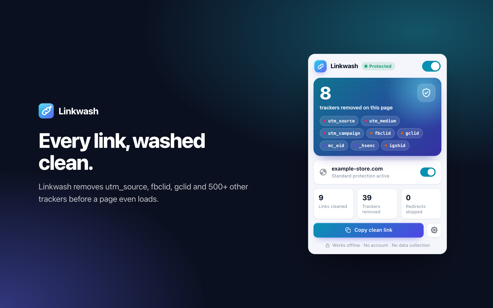

<p align="center">
  
</p>

<h1 align="center">Linkwash</h1>
<p align="center"><b>Clean links. Zero trackers.</b><br>
A Chrome extension that removes tracking parameters such as <code>utm_source</code>, <code>fbclid</code> and <code>gclid</code> from every link, before the page loads.</p>

<p align="center">
  
</p>

## Features

- **556 tracking parameters**: campaign tags (UTM, Matomo, HubSpot), ad click IDs (Google, Meta, Microsoft, TikTok, X, LinkedIn…), email trackers (Mailchimp, Marketo, Klaviyo…) and analytics IDs (Google Analytics, Webtrekk, Piano…).
- **Site rules for 22 popular sites**: Amazon, eBay, AliExpress, Temu, Etsy, Walmart, Booking.com, Zalando, Google, Bing, YouTube, Facebook, Instagram, X, TikTok, Reddit, LinkedIn, Pinterest, Spotify, Medium, Twitch and Netflix. Short names like `ref` or `si` are only removed where they're tracking.
- **Skips redirect pages**: wrapped links (`google.com/url?q=…`, `l.facebook.com/l.php?u=…`, YouTube, Reddit, LinkedIn, Steam, DuckDuckGo, Bing, GMX/WEB.DE…) go straight to the destination.
- **Blocks click pings** (`<a ping>`), which report which link you clicked.
- **Clean copying**: right-click → *Copy clean link*. *Copy link address* also gives the clean URL. The popup button and <kbd>Alt</kbd>+<kbd>Shift</kbd>+<kbd>C</kbd> copy the current page's clean link.
- **You stay in control**: eight categories to switch on or off, a pause switch per site, your own parameters and a link cleaner tool.
- **Affiliate tags are kept by default**, so creators still get paid. You can turn them off.
- **17 languages**: English, Deutsch, Türkçe, Español, Français, Italiano, Português (Brasil), Nederlands, Polski, Русский, Українська, العربية, हिन्दी, 日本語, 한국어, 简体中文 and Bahasa Indonesia.
- **Private**: no account, no servers, no analytics. Everything runs in your browser. See [PRIVACY.md](PRIVACY.md).
- Light and dark mode, statistics, settings backup.

## How it works

Linkwash turns its rule list into Chrome [`declarativeNetRequest`](https://developer.chrome.com/docs/extensions/reference/api/declarativeNetRequest) rules. Chrome removes the parameters before the request is sent, so the tracking value never reaches the server. This is fast and works even while the extension's service worker is asleep.

A small content script cleans links when you click or right-click them. That's how redirect wrappers get unwrapped and how *Copy link address* copies a clean URL.

| File | Purpose |
| --- | --- |
| `src/shared/rules.js` | The rule database: global parameters, site rules and redirect wrappers |
| `src/shared/engine.js` | URL cleaning and conversion to `declarativeNetRequest` rules |
| `src/background.js` | Service worker: keeps the rules in sync, counter, context menu, shortcut |
| `src/content/content.js` | Cleans links on click and removes ping attributes |
| `src/popup/`, `src/options/` | Popup and settings page |
| `_locales/` | Translations |

There is no build step. The repository *is* the extension.

## Install

**From the Chrome Web Store:** coming soon.

**From source (developer mode):**

1. Download this repository (or the zip from the [latest release](https://github.com/malias55/trackblocker-chrome-extension/releases)) and unzip it.
2. Open `chrome://extensions` and switch on **Developer mode** (top right).
3. Click **Load unpacked** and select the folder.

## Adding rules

Edit `src/shared/rules.js`:

- A parameter that is tracking on every site goes in `GLOBAL_PARAMS`.
- A parameter that is only tracking on one site goes in that site's entry in `SITES`. Domains match subdomains too, and `amazon.*` matches every country domain.
- A link wrapper goes in `REDIRECTS`.

Then run the tests. They check for duplicates, overlapping sites and parameters that sites need to work.

## Development

```bash
npm install
npx playwright install chromium
npm test              # unit tests (engine, rules, manifest, translations)
npm run test:e2e      # loads the extension in Chromium and checks real navigations
npm run icons         # renders icons/*.png
npm run screenshots   # renders the Chrome Web Store images in store/images
npm run package       # builds dist/linkwash-<version>.zip
```

The end-to-end tests point every hostname to a local server, so they can check that `https://www.amazon.de/dp/…?ref=…` really reaches the server without `ref`.

### Releasing

Bump `version` in `manifest.json` and `package.json`, then push a tag such as `v1.0.1`. The release workflow runs the tests, attaches the zip to a GitHub release and, once these repository secrets are set, publishes to the Chrome Web Store: `CWS_EXTENSION_ID`, `CWS_CLIENT_ID`, `CWS_CLIENT_SECRET` and `CWS_REFRESH_TOKEN` ([how to get them](https://github.com/fregante/chrome-webstore-upload-keys)).

## License

[MIT](LICENSE)
